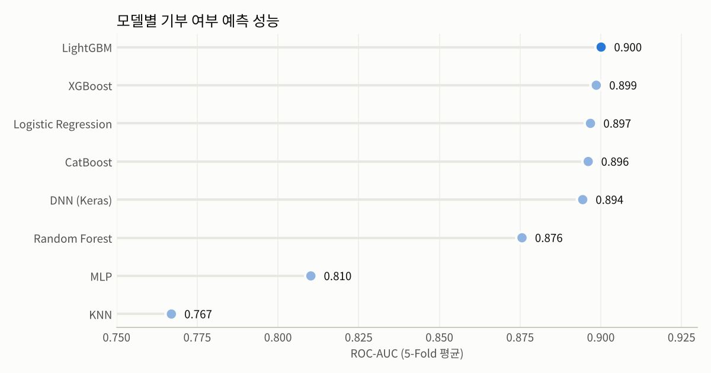

# 기부자 예측: 사회조사 5개년 통합 데이터로 기부 여부 예측하기

통계청 **사회조사** 마이크로데이터(2015·2017·2019·2021·2023년, 약 18.5만 명)를 하나로 묶어, 개인의 복지·사회참여·여가·소득·노동 특성으로 **기부 경험 여부**를 예측한 프로젝트입니다.



## 한눈에 보기

| 항목 | 내용 |
|---|---|
| 데이터 | 통계청 사회조사 (복지, 사회참여, 문화와 여가, 소득과 소비, 노동 부문) 2015~2023년 격년 5개년 |
| 규모 | 184,915명 × 482개 변수 → 전처리 후 435개 피처 |
| 타깃 | 기부 여부 (비기부 75% / 기부 25%의 불균형) |
| 방법 | 연도별 문항 매칭·코드 표준화 → 결측·인코딩·누수 변수 제거 → 8개 모델 5-Fold 교차검증 |
| 결과 | **LightGBM이 ROC-AUC 0.900**으로 가장 높았고, XGBoost·로지스틱 회귀도 0.897~0.899로 비슷한 수준 |

## 왜 이 문제인가

기부 참여율은 해마다 떨어지고 있어, 모금 기관 입장에서는 "누가 기부할 가능성이 높은가"를 아는 것이 홍보 대상과 예산을 정하는 데 직접 연결됩니다. 이 프로젝트는 설문 응답만으로 기부 경험자를 얼마나 가려낼 수 있는지, 그리고 그때 어떤 모델이 적합한지를 확인하는 것을 목표로 했습니다.

## 가장 어려웠던 부분: 5개년 설문을 하나로 맞추기

사회조사는 해마다 문항명, 선택지 코드, 포함 문항이 조금씩 바뀝니다. 그대로 이어 붙이면 같은 질문이 다른 컬럼이 되거나, 같은 코드가 다른 뜻이 됩니다.

1. **문항명 매칭** ([01](notebooks/01_column_matching.ipynb)): 연도별 컬럼 포함 여부를 표로 비교하고, `rapidfuzz` 유사도로 후보를 찾은 뒤 18개 문항은 직접 확인해 매핑 사전을 만들었습니다. (예: `레저시설_스키장이용횟수` ↔ `레저시설_스키장스케이트장이용횟수`)
2. **코드 표준화** ([02](notebooks/02_merge_and_standardize.ipynb)): 연도별로 달라진 선택지 코드를 하나의 기준으로 재매핑했습니다. 혼인상태, 재학상태, 노후준비방법, 희망 복지서비스 등 항목별로 규칙을 정했고, 2015·2017년의 "참여단체 1~3순위" 응답은 2019년 이후 형식에 맞춰 단체 유형별 0/1 더미로 바꿨습니다.

## 분석 흐름

| 단계 | 노트북 | 내용 |
|---|---|---|
| 1 | [01_column_matching](notebooks/01_column_matching.ipynb) | 연도별 문항명 비교 및 매핑 |
| 2 | [02_merge_and_standardize](notebooks/02_merge_and_standardize.ipynb) | 연도별 코드 표준화 후 세로 결합 (184,915 × 482) |
| 3 | [03_data_check](notebooks/03_data_check.ipynb) | 컬럼별 타입·결측률·분포 점검 |
| 4 | [04_drop_missing_over50](notebooks/04_drop_missing_over50.ipynb) | 결측 50% 이상 변수 310개 제거 → 172개 |
| 5 | [05_age_cols_and_onehot](notebooks/05_age_cols_and_onehot.ipynb) | 중복되는 연령 파생 변수 제거, 직업·산업 분류 원-핫 인코딩 |
| 6 | [06_feature_matrix](notebooks/06_feature_matrix.ipynb) | 결측 대체(수치형 중앙값, 범주형 최빈값), 저카디널리티 원-핫, 저분산·고상관(>0.9) 변수 제거, 원본/표준화/MinMax 세 버전 생성 |
| 7 | [07_leakage_removal](notebooks/07_leakage_removal.ipynb) | 타깃과 사실상 같은 정보를 담은 변수 제거 (아래 참고) |
| 8 | [08_model_comparison_cv](notebooks/08_model_comparison_cv.ipynb) | 8개 모델 5-Fold 교차검증 비교 |

### 데이터 누수 점검

타깃과의 상관을 확인했더니 `분류코드_기부여부`는 타깃 그 자체(상관 1.0)였고, `미기부사유`·`기부희망분야`는 기부 경험이 있어야만(또는 없어야만) 응답하는 문항이었습니다. 이 25개 변수를 제거한 뒤 모델링했습니다 (460 → 435개 피처).

### 모델링 설정

- 5-Fold Stratified 교차검증, 각 Fold 안에서 스케일링(MinMax)과 언더샘플링(소수:다수 = 1:2)을 학습 데이터에만 적용
- 각 모델은 학습 Fold 안에서 RandomizedSearchCV(3-Fold, F1 기준)로 하이퍼파라미터 선택
- 비교 모델: 로지스틱 회귀, 랜덤 포레스트, XGBoost, LightGBM, CatBoost, MLP(sklearn), Keras DNN, KNN

## 결과

5-Fold 평균 (표준편차는 모두 0.003 이하로 Fold 간 차이가 작았습니다)

| 모델 | ROC-AUC | Balanced Acc. | 기부자 재현율 | 기부자 정밀도 |
|---|---|---|---|---|
| **LightGBM** | **0.900** | **0.805** | 0.724 | 0.678 |
| XGBoost | 0.899 | 0.802 | 0.716 | 0.678 |
| Logistic Regression | 0.897 | 0.801 | 0.716 | 0.674 |
| CatBoost | 0.896 | 0.801 | 0.721 | 0.669 |
| Keras DNN | 0.894 | 0.793 | 0.693 | 0.681 |
| Random Forest | 0.876 | 0.688 | 0.411 | 0.800 |
| MLP | 0.810 | 0.735 | 0.648 | 0.547 |
| KNN* | 0.767 | 0.669 | – | – |

- 노트북 코드에서는 "기부하지 않음"이 양성 클래스(1)라서, 원본 결과 파일의 Precision·Recall은 비기부자 기준입니다. 위 표의 기부자 재현율은 원본의 Specificity, 기부자 정밀도는 TN/(TN+FN)으로 다시 계산했습니다.
- LightGBM 기준으로 실제 기부자 10명 중 약 7명을 찾아내고, 기부자로 예측한 사람 중 약 68%가 실제 기부자입니다. 무작위로 고르면 25%이므로 약 2.7배 효율입니다.
- 랜덤 포레스트는 정밀도는 높지만 기부자를 41%만 찾아내 실용성이 떨어졌습니다.
- 부스팅 모델과 로지스틱 회귀의 차이가 0.003 이내로 작아서, 해석이 쉬운 로지스틱 회귀도 충분히 대안이 될 수 있습니다.
- \*KNN은 메모리 문제로 다른 모델과 같은 Fold가 아니라 언더샘플링된 전체 데이터에서 따로 평가해 직접 비교는 어렵습니다.

Fold별 상세 결과는 [`results/`](results/)에 있습니다. 표준화 버전(`_std`)도 결과가 거의 같아, 스케일링 방식은 성능에 영향이 없었습니다.

## 한계와 다음 단계

- **남은 누수 가능성**: `향후기부의사여부`, `유산기부의사여부`, `분류코드_물품기부여부` 등은 기부 경험과 매우 밀접해 실제 예측 상황에서는 쓸 수 없을 수 있습니다. 이 변수들을 뺀 버전과 비교하는 것이 다음 과제입니다.
- **변수 해석 미완료**: 어떤 특성이 기부를 예측하는지(SHAP 등)는 아직 정리하지 않았습니다.
- **홀드아웃 테스트 미완료**: 별도 테스트셋 평가 노트북([archive/final_holdout_test](archive/final_holdout_test.ipynb))은 메모리 부족으로 끝까지 실행되지 않았습니다.
- 설문 가중치(가구원가중값)는 반영하지 않았습니다.

## 폴더 구조

```
donor-prediction/
├── notebooks/   최종 분석 흐름 (01 → 08 순서)
├── results/     모델 성능 결과 (Fold별, 모델별 요약)
├── images/      README 그림
├── archive/     초기 실험과 이전 버전 노트북 (출력 삭제)
└── data/        원본 데이터 위치 (저장소에는 포함하지 않음)
```

## 실행 방법

```bash
pip install -r requirements.txt
```

1. 통계청 [MDIS 마이크로데이터 통합서비스](https://mdis.kostat.go.kr)에서 사회조사 2015·2017·2019·2021·2023년 데이터를 내려받습니다.
2. 연도별 파일을 `{연도}_복지_사회참여_문화와여가_소득과소비_노동.csv` 이름으로 노트북과 같은 폴더에 둡니다.
3. `notebooks/`의 노트북을 01번부터 순서대로 실행합니다.

원본 마이크로데이터는 이용 약관상 재배포할 수 없어 저장소에 포함하지 않았습니다.

## 사용 기술

Python, pandas, scikit-learn, imbalanced-learn, XGBoost, LightGBM, CatBoost, TensorFlow/Keras, rapidfuzz
